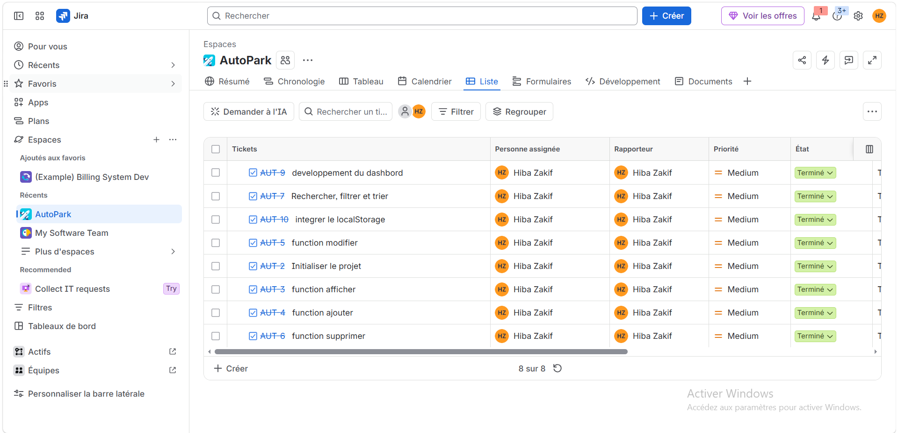
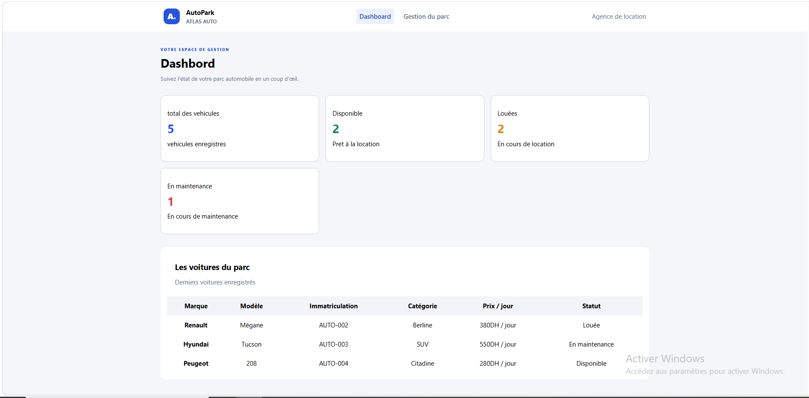
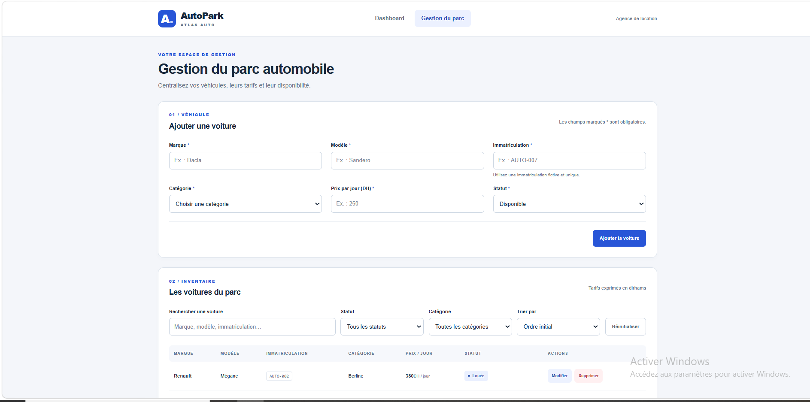

# 🚗 Atlas Auto — AutoPark

> Application web responsive de gestion du parc automobile d'une agence de location.

## 📋 Table des matières

- [À propos du projet](#-à-propos-du-projet)
- [Objectifs pédagogiques](#-objectifs-pédagogiques)
- [Fonctionnalités](#-fonctionnalités)
- [Technologies utilisées](#-technologies-utilisées)
- [Structure du projet](#-structure-du-projet)
- [Installation et lancement](#-installation-et-lancement)
- [Gestion du projet](#-gestion-du-projet)
- [Captures d'écran](#-captures-décran)
- [Liens du projet](#-liens-du-projet)
- [Conclusion](#-conclusion)
- [Licence](#-licence)

---

## 📖 À propos du projet

**AutoPark**, est un projet individuel réalisé dans le cadre de la formation Développeur Web chez **YouCode**.

Il s'agit d'une application web responsive destinée à la gestion du parc automobile d'une agence fictive de location de voitures.

L'application permet de consulter les véhicules, gérer leurs informations, modifier leurs tarifs, suivre leur disponibilité et visualiser les statistiques du parc à travers un tableau de bord.

Le projet est composé de deux interfaces principales :

- **Gestion du parc (`voitures.html`) :** permet de gérer les véhicules et leurs informations.
- **Dashboard (`index.html`) :** permet de visualiser les principaux indicateurs du parc automobile.

Les données sont stockées localement grâce à `localStorage`, sans nécessiter de backend ni de base de données.

### Les principaux axes du projet

- Gestion dynamique des véhicules.
- Manipulation du DOM avec JavaScript ES6+.
- Validation des formulaires.
- Recherche, filtrage et tri des données.
- Persistance des données avec LocalStorage.
- Création d'un dashboard responsive.

## 🎯 Objectifs pédagogiques

Ce projet a pour objectif de mettre en pratique les concepts fondamentaux de JavaScript ES6+ et du développement web front-end :

- Manipuler le DOM et générer dynamiquement des éléments HTML.
- Réaliser les opérations CRUD (Create, Read, Update, Delete).
- Valider les formulaires et gérer les messages d'erreur.
- Implémenter des fonctionnalités de recherche, de filtrage et de tri.
- Manipuler les tableaux d'objets avec les méthodes `map()`, `filter()`, `find()`, `some()` et `reduce()`.
- Utiliser les fonctions fléchées, les template literals, la déstructuration et le spread/rest.
- Organiser le code avec les modules ES6 (`import` / `export`).
- Assurer la persistance des données avec `localStorage`.
- Concevoir une interface responsive avec HTML5 et CSS3.

## ✨ Fonctionnalités

### 🚘 Gestion du parc automobile

- Affichage dynamique des véhicules dans un tableau HTML.
- Ajout de nouveaux véhicules.
- Modification des informations d'un véhicule.
- Suppression avec confirmation.
- Génération automatique d'identifiants uniques.
- Gestion des catégories : Citadine, Berline et SUV.
- Gestion des statuts : Disponible, Louée et En maintenance.

### 🔍 Recherche, filtrage et tri

- Recherche instantanée par marque, modèle ou immatriculation.
- Recherche insensible à la casse.
- Filtrage par catégorie.
- Filtrage par statut.
- Tri des véhicules par prix journalier croissant ou décroissant.
- Combinaison des différents critères de recherche.
- Réinitialisation des filtres.

### ✅ Validation des formulaires

- Vérification des champs obligatoires.
- Refus des champs contenant uniquement des espaces.
- Vérification de la validité du prix journalier.
- Détection des immatriculations en double.
- Affichage des messages d'erreur à proximité des champs concernés.

### 💾 Persistance des données

- Sauvegarde automatique des modifications dans `localStorage`.
- Récupération des données après rechargement de la page.
- Conservation des données même lorsque le parc est volontairement vidé.

### 📊 Dashboard

- Affichage du nombre total de véhicules.
- Nombre de véhicules disponibles.
- Nombre de véhicules loués.
- Nombre de véhicules en maintenance.
- Actualisation des indicateurs à partir des données enregistrées.

### 📱 Interface responsive

- Interface adaptée aux ordinateurs, tablettes et smartphones.
- Navigation entre le dashboard et la gestion du parc.
- Présentation cohérente entre les deux pages.

## 🛠️ Technologies utilisées

| Technologie / Outil | Utilisation |
|---|---|
| HTML5 | Structure et sémantique des pages |
| CSS3 | Mise en forme et responsive design |
| Tailwind CSS | Stylisation et conception des interfaces |
| JavaScript ES6+ | Logique applicative et interactions DOM |
| LocalStorage | Persistance locale des données |
| Git | Gestion des versions |
| GitHub | Hébergement du code source |
| Jira | Organisation et suivi des tâches |

## 📁 Structure du projet

```text
Atlas-Auto/
│
├── index.html
├── voitures.html
│
├── css/
│   └── style.css
│
└── js/
    ├── data.js
    ├── dashboard.js
    └── voitures.js
```

### Description des fichiers

- `index.html` : page principale du dashboard.
- `voitures.html` : page de gestion du parc automobile.
- `css/style.css` : contient les styles personnalisés de l'application.
- `js/data.js` : contient les données initiales des véhicules.
- `js/dashboard.js` : gère les indicateurs et les statistiques du dashboard.
- `js/voitures.js` : gère les fonctionnalités de gestion des véhicules.

## 🚀 Installation et lancement

### Prérequis

- Un navigateur web moderne.
- [Visual Studio Code](https://code.visualstudio.com/).
- L'extension Live Server pour Visual Studio Code.

### Étapes d'installation

**1. Cloner le dépôt GitHub**

```bash
git clone https://github.com/username/atlas-auto.git
```

**2. Accéder au dossier du projet**

```bash
cd Atlas-Auto
```

**3. Ouvrir le projet dans Visual Studio Code**

```bash
code .
```

**4. Lancer l'application**

Ouvrir le fichier `index.html` avec l'extension Live Server.

L'application sera accessible depuis le navigateur à l'adresse locale générée par Live Server.

> **Important :** Le projet utilise des modules JavaScript ES6. Il est donc nécessaire de lancer l'application via un serveur local plutôt que d'ouvrir directement les fichiers HTML.

## 📌 Gestion du projet

La gestion et le suivi du projet ont été réalisés individuellement à l'aide de **Jira**, en organisant le travail sous forme de User Stories et d'Issues.

Un tableau Kanban a été utilisé pour suivre l'avancement des différentes tâches.

### Organisation du tableau Kanban

| Colonne | Description |
|---|---|
| To Do | Tâches à réaliser |
| In Progress | Tâches en cours de réalisation |
| In Review | Tâches en attente de validation |
| Done | Tâches terminées |

### 📷 Tableau Jira



Cette organisation a permis de structurer les différentes étapes de développement et de suivre leur progression.

## 📸 Captures d'écran

### Dashboard



### Gestion du parc automobile



## 🔗 Liens du projet

- **Live Demo :** [Voir l'application](https://hiba-zakif.github.io/auto-park-starter/)
- **GitHub Repository :** [Consulter le code source](https://github.com/hiba-zakif/auto-park-starter.git)
- **Jira Board :** [Consulter le tableau de gestion](https://zakifhiba.atlassian.net/jira/software/projects/AUT/list?jql=project+%3D+AUT+ORDER+BY+cf%5B10019%5D+ASC&atlOrigin=eyJpIjoiNzY5ZTg5MDYyOGVjNDk5ZmIyZGI1OTRlMjg3NGE2YjYiLCJwIjoiaiJ9)

## 🏁 Conclusion

La réalisation d'AutoPark a permis de mettre en pratique les concepts fondamentaux du développement front-end, notamment JavaScript ES6+, la manipulation du DOM, les opérations CRUD, la gestion des événements et la persistance des données avec `localStorage`.

Ce projet a également permis de développer des compétences en organisation du travail, en gestion de projet avec Jira et en utilisation de Git et GitHub.

Il représente une mise en pratique concrète des compétences acquises durant la formation chez YouCode.

## 📄 Licence

Projet pédagogique réalisé individuellement dans le cadre de la formation Développeur Web et Web Mobile chez YouCode.

© 2026 — Projet Atlas Auto. Tous droits réservés.
